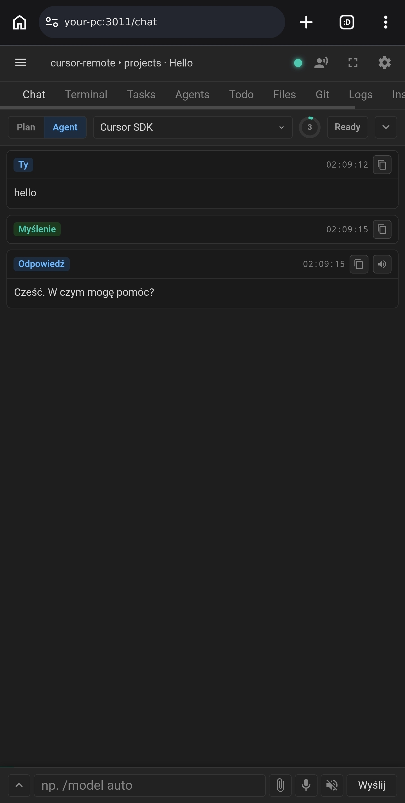
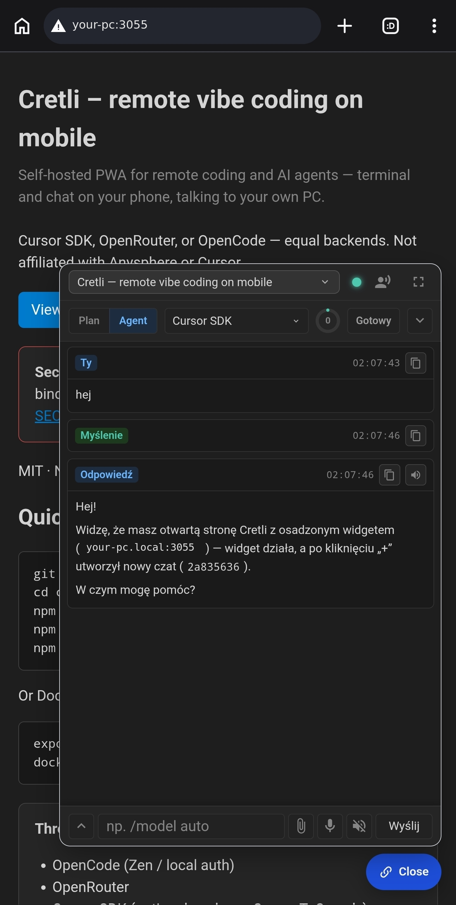

# Cretli — one task queue, many coding agents

Official website: [cretli.com](https://cretli.com)

[](https://github.com/cretli/cretli/actions/workflows/ci.yml)
[](LICENSE)
[](https://nodejs.org)

**Cretli** is a self-hosted control room for AI coding agents. Plan a task, let one model
implement it and a **different** model review it — Claude Code, Codex, DeepSeek,
OpenRouter and more — from your desktop or your phone, on your own machine.

> **Status:** early/experimental (`v0.6.0`). The server exposes a full shell — read
> [SECURITY.md](SECURITY.md) before putting it on a network.
>
> Cretli is **not affiliated with** Anysphere, Anthropic, OpenAI, Google or any other
> model vendor. Trademarks belong to their owners. See [NOTICE](NOTICE).

<table>
  <tr>
    <td align="center" valign="top" width="50%">
      
      <br />
      <strong>Phone or desktop</strong> — chat, terminal, todos, files and git in one PWA, the same live session on every device.
    </td>
    <td align="center" valign="top" width="50%">
      
      <br />
      <strong>Widget</strong> — the same agent chat embedded on a project page, with page context.
    </td>
  </tr>
</table>

## Why

Coding agents are good and getting cheaper, but each vendor has its own app, its own limits
and its own blind spots. Cretli puts them behind one workflow:

- **Plan → implement → cross-review.** A todo gets a plan, one harness implements it, a
  different one reviews it, and tests decide. A second model catches what the first one
  is blind to.
- **Switch models, keep the work.** Hit a usage limit or want a cheaper model? Continue the
  same todo on another harness — the plan, history and review state stay in Cretli.
- **No vendor lock-in.** Twelve harnesses today; when a new model gets popular, it is a
  plugin away ([harnesses/README.md](harnesses/README.md)).
- **Your machine, any device.** Self-hosted, localhost by default, installable as a PWA on
  your phone, with a real terminal, files and git next to the chat.

## How a task flows

1. **Plan.** Create a todo, write or generate a plan, and optionally let two independent
   reviewer models check it before you approve it.
2. **Implement and review.** Start the work on one harness; Cretli starts the review on a
   different model, runs the verify tests and loops on fixes until the review passes.
3. **Integrate.** Each task can run in its own Git worktree; the result is merged back when
   you accept it. Nothing is pushed for you.

The optional **Workspace Watcher** runs this loop on autopilot for ready todos; plan approval
always stays with you ([docs/workspace-watcher.md](docs/workspace-watcher.md)).

## Harnesses

| Tier | Harnesses |
|------|-----------|
| **Recommended** | Claude Code, Codex, DeepSeek, OpenRouter |
| **Available** | OpenCode, Cursor SDK, Qwen Code, Mistral, Z.AI, MiMo, CodeBuddy |
| **Experimental** | Antigravity |

You need **one** to chat; terminal, files and git work without any key. Setup for each:
[docs/harnesses.md](docs/harnesses.md).

## Quick start

Requires Node.js 22.18+ (see `engines` in `package.json`).

```bash
git clone https://github.com/cretli/cretli.git
cd cretli
npm install
npm run build:front:prod   # build the SPA into public/dist
npm start                  # binds 127.0.0.1, HTTPS
```

Open **https://localhost:3011**. On first run you set the access password and pick a chat
backend. Without HTTPS: `USE_HTTPS=0 npm start` → `http://localhost:3011`.

Docker (host port published to localhost only):

```bash
export CRETLI_SETUP_TOKEN="$(openssl rand -hex 16)"
docker compose up --build
# then open https://localhost:3011 and paste CRETLI_SETUP_TOKEN on first-run setup
```

Linux, macOS, WSL2, Termux and LAN/HTTPS: [docs/INSTALL.md](docs/INSTALL.md). If the page
does not connect: [docs/TROUBLESHOOTING.md](docs/TROUBLESHOOTING.md).

## Security

- Default bind is **127.0.0.1** (localhost only). LAN is opt-in:
  `npm run start:lan` or `CRETLI_BIND=0.0.0.0`.
- Binding beyond localhost **without a password** requires `CRETLI_SETUP_TOKEN` or the
  process refuses to start (no first-run race on LAN).
- **Do not expose this directly to the Internet.** Use a VPN or SSH tunnel.

Details: [SECURITY.md](SECURITY.md).

## More

- [docs/overview.md](docs/overview.md) — how it works, built-in browser, PWA, HTTPS,
  configuration table, comparison, architecture outline
- [docs/harnesses.md](docs/harnesses.md) — setup for every chat backend
- [docs/ARCHITECTURE.md](docs/ARCHITECTURE.md) — HTTP/WS API and internals
- [CHANGELOG.md](CHANGELOG.md)

## Contributing

PRs and issues are welcome. See [CONTRIBUTING.md](CONTRIBUTING.md) and the
[Code of Conduct](CODE_OF_CONDUCT.md). Run `npm test` before opening a PR (it runs in
parallel and takes a few minutes). Suggested starter tasks are listed in CONTRIBUTING.

## License

[MIT](LICENSE) — see [NOTICE](NOTICE) for third-party terms (`@cursor/sdk` is proprietary
and optional).
